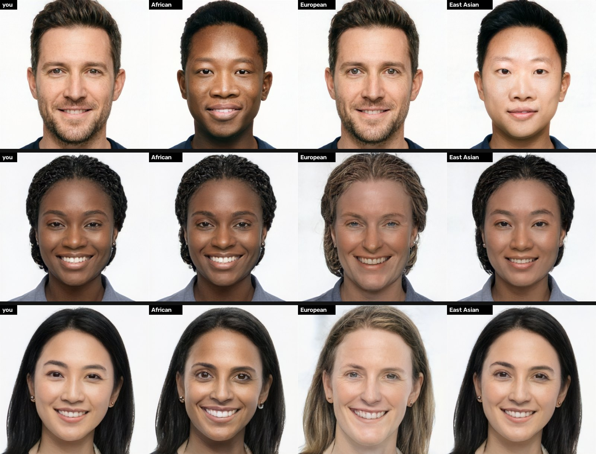
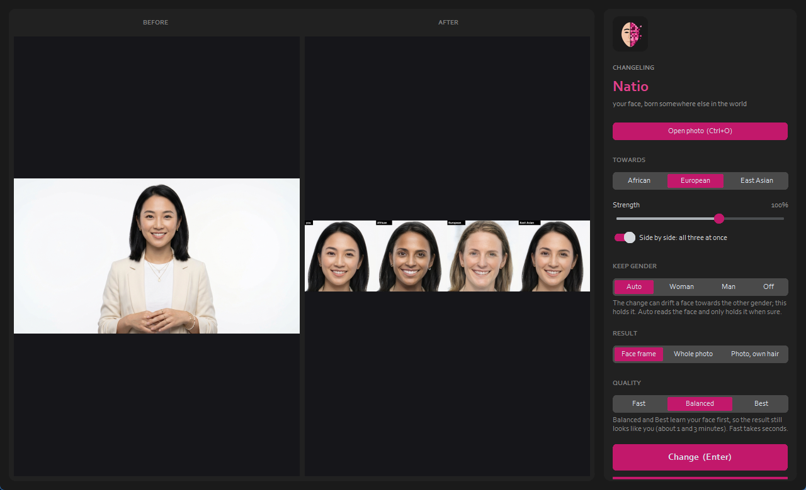

  

# Changeling Natio

**Website:** https://cursedprograms.github.io/Changeling-Natio/

*Part of the Changeling family, all together in [Changeling Studio](https://github.com/CursedPrograms/Changeling-Studio):
[Imago](https://github.com/CursedPrograms/Changeling-Imago) ·
[Imago Realtime](https://github.com/CursedPrograms/Changeling-Imago-Realtime) ·
[Tiresias](https://github.com/CursedPrograms/Changeling-Tiresias) (gender) ·
[Chronos](https://github.com/CursedPrograms/Changeling-Chronos) (age) ·
**Natio** (where in the world) ·
[Cosmeta](https://github.com/CursedPrograms/Changeling-Cosmeta) (makeup, hair, beards) ·
[Echo](https://github.com/CursedPrograms/Changeling-Echo) (voices) ·
[Tonsor](https://github.com/CursedPrograms/Changeling-Tonsor) (hairstyles) ·
realtime: [Tiresias](https://github.com/CursedPrograms/Changeling-Tiresias-Realtime) ·
[Chronos](https://github.com/CursedPrograms/Changeling-Chronos-Realtime) ·
[Natio](https://github.com/CursedPrograms/Changeling-Natio-Realtime) ·
[Cosmeta](https://github.com/CursedPrograms/Changeling-Cosmeta-Realtime).*

Your face as it might look if you'd been born somewhere else in the world. *Natio* is Latin for where you were
born (from *nasci*, to be born); the Romans had no idea of "race" as we use it: they knew people by their
*natio*, the place and people they came from. Every face above is an AI-generated person who doesn't exist.

It's made for curiosity and for seeing how much of a face is shared: use it on yourself, on generated people, or
on people who agreed. Don't use it to mock anyone or to pass someone off as someone they're not.

## Use it

Python 3.9 - 3.12 and an NVIDIA GPU (4 GB is enough). Start `run.bat` (or `.\run.ps1`, `./run.sh`): the first
run sets itself up. If Changeling Tiresias or Chronos is next to it, Natio uses their models instead of
downloading the same 1.3 GB again.

| Control | Does |
| --- | --- |
| **Towards** | African, European or East Asian |
| **Strength** | 20 - 150 %: how far along the way |
| **Side by side** | all three at once, next to the photo, from one run |
| **Keep gender** | Auto, Woman, Man, Off: the change can drift a face towards the other gender; this holds it |
| **Result** | the face frame (default), the whole photo, or the photo with its own hair |
| **Quality** | Fast (seconds), Balanced and Best (learn the face first, about 1 and 3 minutes) |

Command line: `run.bat photo.jpg --towards east_asian`, `run.bat photo.jpg --side-by-side`, plus `--strength`,
`--keep-gender`, `--quality`, `--whole-photo`, `--keep-hair`.

## How it works, and its limits

The same engine as Tiresias and Chronos: the face is aligned, inverted into StyleGAN2's latent space (e4e), the
generator learns the face (pivotal tuning), and the latent moves along a direction.

- **Three coarse directions.** StyleGAN2 learned them from FFHQ; their authors named them race_black, race_white
  and race_yellow, and Natio calls them African, European and East Asian. They are broad and blunt: most of the
  world (South Asia, the Middle East, North Africa, the Americas, the Pacific, and everyone in between) has no
  direction of its own.
- **To a place, not by an amount.** Natio measures where the face already sits along each direction and moves it
  to where faces from that region typically sit (the other two to where everyone else sits). A face asked for a
  look it already has barely changes; nothing is pushed past the real range into a caricature.
- **No caricatures.** The East Asian direction also learned near-closed eyes; Natio opens the eyes again by as
  much as the face moved along it. Gender is held with FairFace, as in Chronos.

## Licenses

The code is MIT (e4e and rosinality's stylegan2-pytorch are MIT). The StyleGAN2 FFHQ weights are under NVIDIA's
non-commercial license, so this is for personal and research use.

---

 

© Cursed Entertainment 2026

 

 

  

